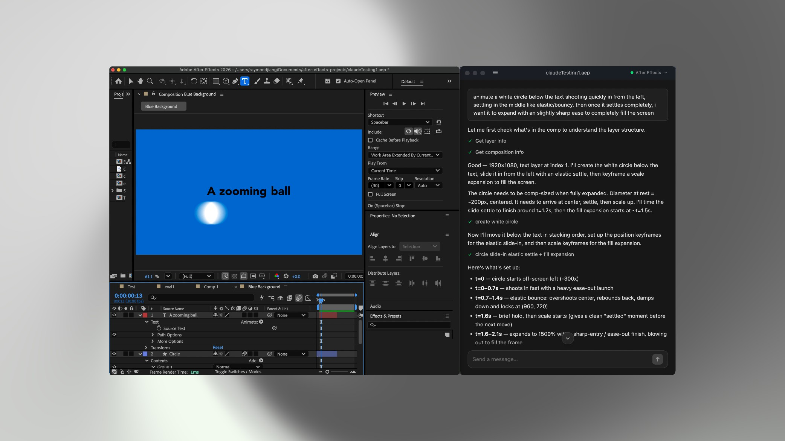

# Cubic



**An agent harness for After Effects.** Cubic runs a tool-using Claude loop against a live After Effects project: it reads project state, writes ExtendScript, executes it inside AE, and self-corrects from execution errors until the animation is built.

Ask it to "make this text pop in" or "add a smooth slide transition," and the animation appears natively in your After Effects project.

Built for video editors, not developers: a standalone desktop app with a consumer-style chat UI, no scripting required.

## How it works

```
┌─────────────────┐     IPC      ┌──────────────────┐   Claude calls    ┌────────────────────────────┐
│  Electron app   │◀────────────▶│   Node backend   │──────────────────▶│  Cloudflare Worker proxy   │
│ (React chat UI) │  WebSocket   │  (AE bridge +    │  in prod          │  holds API key + system    │
└─────────────────┘◀────────────▶│   Claude brain)  │  (dev: direct)    │  prompt; gates auth+billing│
                                 └────────┬─────────┘                   └──────────────┬─────────────┘
                                          │ WebSocket (127.0.0.1,                      │
                                          │  OS-assigned port, token)                  ▼
                                          ▼                             Anthropic API · Supabase · Stripe
                                 ┌──────────────────┐
                                 │  CEP extension   │
                                 │  in After Effects│ ── runs ExtendScript
                                 └──────────────────┘
```

1. You type a request in the desktop app.
2. The **Claude brain** (inside the Node backend) fetches live AE state — active comp, selected layers, assets — and reasons about the motion.
3. In the shipped app, that Claude call routes through the **hosted proxy** — a Cloudflare Worker that holds the API key + server-side system prompt, verifies your account + subscription, and meters usage before forwarding to Anthropic. (In local dev the brain calls Anthropic directly, no proxy.)
4. The brain executes **ExtendScript commands** over a local WebSocket bridge into a CEP extension running inside After Effects.
5. If AE throws a compile error, the agent feeds it back to the model and retries — a forward **self-healing loop** (no undo), with a pre-turn `.aep` snapshot for safety.
6. The result appears natively in your AE timeline.

> For the full system design (proxy gating, Supabase/Stripe billing, analytics, packaging), see [`docs/architecture.md`](docs/architecture.md).

## Project structure

This is a monorepo of five independent packages (no root `package.json`).

```
cubic/
├── app/                  # Electron desktop app — React + Zustand + Tailwind chat UI
│   ├── src/main/         #   Electron main: window, IPC, auth/billing/updater/analytics, spawns the backend
│   ├── src/preload/      #   IPC security boundary
│   ├── src/renderer/     #   React chat UI (transcript, sidebar, live agent events)
│   └── src/shared/       #   Shared IPC types
│
├── server/
│   ├── ae-bridge/        # WebSocket bridge + ExtendScript handlers + CEP extension
│   │   ├── src/serve.ts  #   Standalone backend entrypoint (spawned by Electron)
│   │   ├── src/bridge/   #   WS server relaying commands to the CEP worker in AE
│   │   ├── src/scripts/  #   ExtendScript (.jsx) handlers: layers, text, shapes,
│   │   │                 #     animation, effects, masks, footage, markers, etc.
│   │   └── cep-extension/ #  CEP panel running inside AE (runs the bundled .jsx)
│   │
│   └── ai/               # Claude brain — the agent loop
│       ├── src/agent/    #   Iteration loop, tool execution, self-healing, cancel/steer
│       ├── src/context/  #   Live AE state fetching, caching, prompt formatting
│       ├── src/llm/      #   Anthropic SDK wrapper (direct + proxy modes)
│       └── src/bridge/   #   Loopback client into the AE bridge
│
├── proxy/                # Cloudflare Worker — hosted LLM proxy + billing gate + release feed
│   └── src/secrets/      #   System prompt + tool catalog, injected server-side
│
├── supabase/             # Postgres schema + RPCs + Stripe/billing edge functions
│
└── docs/                 # Architecture, schema + release docs (architecture.md, db-schema.md, updates.md)
```

## Agent harness

- **Loop** — multi-step tool use, capped at 15 iterations per turn; steer with queued follow-ups mid-run, or cancel at iteration boundaries (Esc).
- **Context** — live AE state (active comp, selected layers, assets) is fetched and injected before each turn.
- **Feedback** — ExtendScript errors are returned to the model as tool results, and it fixes the script and retries.
- **State** — pre-turn `.aep` snapshots for restore; auto-compaction near the context limit.
- **Traces** — every session is an append-only JSONL trajectory of the full message history, including tool calls and results; it survives crashes and reloads.

## Engineering highlights

- **The prompt never ships to users.** The system prompt and tool catalog live only in a Cloudflare Worker and are injected server-side. The desktop build swaps in a stub, and a test fails if the real prompt ever leaks into the bundle.
- **Locked-down local bridge.** The app, backend, and AE panel share one WebSocket bound to `127.0.0.1` on an OS-assigned port, with a per-launch auth token, so a malicious webpage can't drive After Effects.
- **Self-healing agent loop.** ExtendScript errors are fed back to the model, which fixes and retries (up to 15 iterations per turn), with a pre-turn `.aep` snapshot as a safety net.
- **Gated, metered proxy.** Every call passes IP and per-user rate limits, Supabase JWT verification, and a fail-closed entitlement check. Usage is metered by teeing the response stream, so billing adds no latency.
- **One-click install and updates.** A single signed, notarized app installs the AE panel itself. Updates download in the background, apply on restart, and re-copy the panel only when its content hash changes.

## Tech stack

| Layer | Tech |
|-------|------|
| Desktop app | Electron, React, Zustand, Tailwind CSS, TypeScript |
| Build | electron-vite, esbuild |
| Transport | WebSocket (`ws`, loopback + per-launch token auth), Electron IPC |
| AI | Anthropic SDK (Claude Sonnet 4.6 default, configurable) |
| AE scripting | ExtendScript via CEP extension |
| Hosted proxy | Cloudflare Workers, Wrangler |
| Auth / billing | Supabase (Postgres + Auth), Stripe |
| Analytics | PostHog |
| Validation / data | Zod, JSON/JSONL files |
| Testing | Vitest + live tests against AE |

## Getting started

**Prerequisites:** Node 18+, After Effects 2024+, and an `ANTHROPIC_API_KEY`.

```bash
# 1. Build the Claude brain
cd server/ai && npm install && npm run build

# 2. Build the AE bridge (and install the CEP extension into AE)
cd ../ae-bridge && npm install && npm run build:serve && npm run install-plugin

# 3. Build & run the app
cd ../../app && npm install && npm run dev
```

The app launches a native window, spawns the backend, and connects to After Effects. Open a project in AE, and start chatting.

### Configuration

| Variable | Purpose |
|----------|---------|
| `ANTHROPIC_API_KEY` | Required. Claude API key. |
| `CUBIC_MODEL` | `sonnet` (default), `sonnet5`, `haiku`, or `opus` — switch models without rebuild. |
| `CUBIC_ENV` | `local` (default, direct Anthropic calls) or `prod` (routes through hosted proxy). |

### Run modes (direct vs. proxied)

`CUBIC_ENV` forks where Claude calls go. All three modes share the same code path — only the URLs change.

**direct-local** (default) — the agent loop calls Anthropic directly with your `ANTHROPIC_API_KEY`. No proxy, auth, or billing; fastest inner loop.
```bash
npm run dev
```

**full-stack-local** — routes through a *local* Cloudflare Worker (`wrangler dev`) that verifies the Supabase JWT → checks entitlement → injects the system prompt → meters usage, against local emulators (`supabase start` + Stripe test mode). Add `MOCK_UPSTREAM=1` on the wrangler side for zero Anthropic spend.
```bash
# prereqs, in separate terminals: (cd proxy && npx wrangler dev)  +  supabase start
CUBIC_ENV=prod \
CUBIC_PROXY_URL=http://localhost:8787 \
SUPABASE_URL=http://127.0.0.1:54321 \
SUPABASE_ANON_KEY=<anon key from `supabase status`> \
npm run dev
```

**real-prod** — the identical path, pointed at your deployed Worker + cloud Supabase. Packaged/signed builds **bake** these public values (Supabase URL + anon key, proxy URL, PostHog key) at build time, so the shipped app needs no env vars; the invocation below is how to point a *dev* build at the prod backend. If `CUBIC_PROXY_URL` is unset, calls go directly to Anthropic.
```bash
CUBIC_ENV=prod \
CUBIC_PROXY_URL=https://YOUR-WORKER.workers.dev \
SUPABASE_URL=https://YOUR-PROJECT.supabase.co \
SUPABASE_ANON_KEY=<anon_key> \
npm run dev
```

### Production build

```bash
cd app
npm run build    # → out/
npm run start    # preview the build
```

## Status

Cubic is functionally complete: the agent brain, AE bridge, hosted proxy + billing gate, packaging (signed + notarized), and background auto-update are all built and working. It is no longer actively maintained.

See [`docs/architecture.md`](docs/architecture.md) for the system design and [`docs/updates.md`](docs/updates.md) for releasing and auto-updates.
